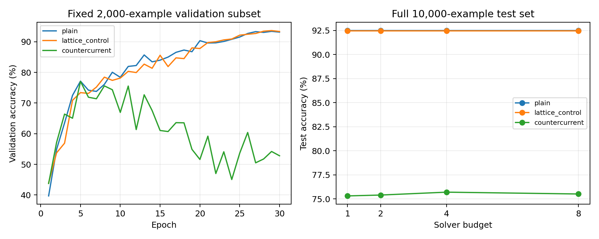
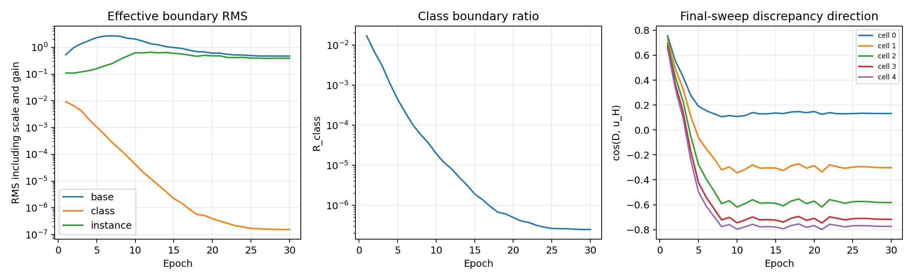

# Experiment 07：ResNet-50 GPU 诊断 pilot

> 最终性能判定：**No-Go**。A/B/C 均完成 30 epochs；C 三项注册 gate 全部失败，
> 按协议停止，不执行 D、不补 seed、不启动长训练。冻结干预与配对统计见下文。

## 协议和预注册判据

基线提交 `2142455`，计算优化 `5f014b0`，DDP 与机制日志修复 `6aa4bdd`。
分支 `resnet50-counterflow-pilot`。A/B 在 2026-10-12 完成；C 的旧启动于
2026-10-13 因 DDP 错误终止，2026-10-15 修复并从头重跑。

四臂使用 CIFAR-10 固定 45k/5k/10k 划分（split seed 0），seed 0，SGD
lr=0.1、momentum=0.9、weight decay=0.0005、global batch=128、30 epochs、
warmup=2，随后 cosine 降到接近 0。GPU 1/3 两卡 DDP，每卡 batch=64，FP32。
环境为 PyTorch 2.6.0+cu124、torchvision 0.21.0+cu124、CUDA build 12.4。
每轮选择 checkpoint 使用固定的前 2,000 张验证样本；最终测试覆盖全部 10,000 张。
这些结果不与 Experiment 06 的 3-epoch 截断 warmup 结果混用。

依次执行 A plain、B lattice control、C countercurrent。仅当 C 同时满足以下三项
才允许 D cocurrent：

1. CC test accuracy 至少高于 lattice control 0.5 pp（门槛 92.96%）。
2. 同为固定 8 步的 reverse-off 掉点至少 1.0 pp。
3. 完整 test set 上 steps=[1,2,4,8] 准确率单调不降。

未通过则停止，不运行 Co、不补 seed、不进入 200 epochs、不在负面结果上继续调参。
只有 CC−Co 至少 0.5 pp 且方向在至少 2 个 seed 上一致才考虑长训练。

## 计算优化与验证

保留 layer3 的 stride-2 入口和 5 个 8×8×1024 可逆 bottleneck。
CC/Co 仅改变 C 注入端和相应传播拓扑。beta=0.1、damping=0.5、boundary、
训练展开 2 步、优化器、batch 和数据划分均保留。

- eval_max_steps：24 → 8；每轮验证固定 8 步，关闭自适应早停。
- inverse_steps：4 → 3。GPU 初始化时五块串联往返相对误差 8.2831e−7，
  低于预注册阈值 1e−4；逐块最大误差 3.7259e−7。
- 完整测试分别记录固定预算准确率曲线和一次自适应早停分布。
- raw/effective boundary RMS、R_class、每层 Q RMS 和 cos(D,u_H) 每轮落盘。
- 全仓库 119 项 unittest 通过；真实 CIFAR-10 两卡两 batch 检查通过；
  合成数据的最终评估流程检查通过。Smoke 的 1 epoch 只验证管线，不进入性能比较。

### 单卡完整 epoch 的优化前后基准

以下均为 RTX 5880 Ada GPU 1、batch=128，训练 45,000、验证 5,000 张。
MAC 范围为实际执行的 Conv2d/Linear 调用，不包含 backward、norm、激活、
kernel 调度或 Python 开销；训练 MAC 用真实 training forward hook 单独测量。
eval MAC 通过 count_macs 强制 eval/tolerance=0 计上界。
本表的首轮训练准确率不用于模型优劣结论。

| 臂 | Train MAC 前→后 (G/sample) | Eval MAC 前→后 (G/sample) | Train 秒 前→后 | Val 秒 前→后 |
|---|---:|---:|---:|---:|
| Plain | 1.298 → 1.298 | 1.298 → 1.298 | 17.72 → 17.87 | 0.72 → 0.72 |
| Lattice control | 1.298 → 1.298 | 1.298 → 1.298 | 17.99 → 17.88 | 0.72 → 0.71 |
| Countercurrent | 7.905 → 6.835 | 60.778 → 19.116 | 46.03 → 43.10 | 18.00 → 8.68 |
| Cocurrent | 7.905 → 6.835 | 60.778 → 19.116 | 48.85 → 60.78 | 17.95 → 10.24 |

Co 的单 epoch 是用户要求的四臂计算基准，并非 Step D 的性能 pilot。
Co patch 后 train 秒数没有改善，因此不能宣称 patch 保证墙钟同比加速；运行负载和
调度影响实际耗时。两 coupled 臂的 Conv/Linear MAC 和参数量相同。
CC 验证峰值从 11.35 GiB 降到 6.35 GiB；训练峰值约 8.45 GiB。
这些单卡 5k 验证数字与下表的两卡训练/2k 验证是不同协议，应分别阅读。

## 四臂 pilot 结果

| 臂 | Epochs | Best val | Test accuracy | Test CE | 参数量 | Train/Eval MAC (G/sample) | 平均 train/val 秒每轮 | 总墙钟秒 | 主卡峰值 GiB |
|---|---:|---:|---:|---:|---:|---:|---:|---:|---:|
| Plain | 30 | 93.40% | 92.48% | 0.26165 | 23,520,842 | 1.298 / 1.298 | 10.89 / 0.26 | 343.98 | 1.837 |
| Lattice control | 30 | 93.65% | 92.46% | 0.24361 | 23,897,624 | 1.298 / 1.298 | 11.33 / 0.26 | 361.63 | 1.802 |
| Countercurrent | 30 | 77.05% | **75.51%** | 0.70002 | 23,897,624 | 6.835 / 19.116 | 31.62 / 3.60 | 1,152.82 | 4.421 |
| Cocurrent | 按 No-Go 未运行 | — | — | — | 23,897,624 | 6.835 / 19.116 | — | — | — |

**参数匹配不等于计算匹配**：control 与 CC 使用同样的可逆 backbone 和唯一参数计数，
但 control 关闭交换后执行单次前向；CC 的训练 forward 为 5.27×、8 步 eval 为
14.73× plain/control 的 Conv/Linear MAC。固定步数曲线保证相同 solver budget，
不意味着 CC 与单次 control 的实际 MAC 相等。本实验不能据此声称同算力优势。

主卡显存数字是 allocated peak，不是 nvidia-smi reserved/全卡显存，也不是两卡之和。
总墙钟从训练环节计起，含验证、诊断、checkpoint 保存及最终评估，不含进程启动。

## 实现故障及解释边界

旧 C 在第 2 个 batch 因 DDP unused-parameter 检查退出，未完成任何 epoch，
该目录当时只有 config/profile，不存在有效性能结果。
索引 119–121 对应 exchange.0/1/2.logit_gamma。
5-cell 同步 Jacobi 仅展开 2 步时，前 3 个 cell 的交换参数尚不能传播到终端 loss；
单元测试确认这些参数的 gradient 为 None。统一开启 DDP find_unused_parameters
后通过两卡跨 batch 检查，不改变 forward 或优化器。
它也意味着本协议并未直接训练所有 cell 的交换系数，这是解释结果时必须保留的限制；
没有为改善 CC 而临时增加展开步数。

日志中 equation_residual 在本实现是 damped 相邻状态变化（step residual），
不是另外计算的独立未阻尼方程残差；不能将该字段直接等同于已经证明精确求解。
自适应评估会冻结已收敛样本，但同一 batch 内仍执行密集张量计算，
solve-step 分布不等于按样本稀疏计算节省的实际 MAC。

另一个保留的源码语义限制：`_transport_c` 每次 sweep 从固定 boundary 沿 G
重建 C proposal，交换后的 C interior 没有作为下一次逆传 proposal 的输入。
本轮没有修改该既有路径。因此结果针对这个具体实现，不能推广成对任意
persistent 双向 BVP solver 或伴随逆流定理的普遍证伪。

## Step C 的预注册判定

| Gate | 实测（完整 10k test） | 判定 |
|---|---|---|
| CC ≥ control + 0.5 pp | 75.51% − 92.46% = **−16.95 pp** | Fail |
| 固定 8 步 reverse-off 掉点 ≥1.0 pp | reverse-off 75.18%；掉点 **0.33 pp** | Fail |
| 1/2/4/8 步准确率单调不降 | 75.31 / 75.40 / 75.70 / 75.51% | Fail：4→8 下降 0.19 pp |

验证子集曲线也不单调：77.10 / 77.15 / 77.80 / 77.05%。

| 固定步数 | CC test accuracy | CC test CE | 实测 Conv/Linear MAC (G/sample) | 相对单次 control MAC |
|---|---:|---:|---:|---:|
| 1 | 75.31% | 0.71363 | 4.788 | 3.69× |
| 2 | 75.40% | 0.70903 | 6.835 | 5.27× |
| 4 | 75.70% | 0.70254 | 10.929 | 8.42× |
| 8 | 75.51% | 0.70002 | 19.116 | 14.73× |

自适应测试与固定 8 步准确率/CE 相同，mean/median/p90 均为 **8/8/8**；
全部 10,000 张达到步数上限。固定测试耗时 17.53 秒，自适应含诊断耗时 25.80 秒。
达到步数上限本身不证明收敛，不能将实际步数分布解释为成功的 test-time refinement。

三臂均完成 30 轮；plain/control 的选定 checkpoint 均为第 29 轮，
CC 的选定 checkpoint 为第 5 轮。CC 第 30 轮 train accuracy 97.85%、val accuracy
52.80%，后期训练改善没有转化为固定 8 步验证改善。测试没有改用其他步数或 checkpoint
来绕过预注册 gate。以下机制轨迹会区分第 30 轮和被选中的第 5 轮。

**立即停止 Step D**。没有 Co-current pilot 结果，因此不能声称本轮测得 CC≈Co
或 CC 输给 Co；Co 的计算基准不等于 30-epoch 性能结果。

## 机制与统计

### Boundary 训练轨迹（固定 16 张验证样本）

RMS 的 raw 值在 JSON 中保留；下表 effective RMS 包括可学习 scale 和 global gain，
分量顺序均为 base/class/instance。Ratio 定义为分量 L2 norm / combined boundary L2 norm，
三者不要求加和为 1。

| Epoch | Base effective RMS | Class effective RMS | Instance effective RMS | R_class | Global gain |
|---|---:|---:|---:|---:|---:|
| 1 | 0.53158 | 0.0093213 | 0.11105 | 0.0171646 | 3.4476 |
| 5（选定 checkpoint） | 2.33504 | 0.00105563 | 0.16033 | 0.00045102 | 5.3026 |
| 30（轨迹终点） | 0.47336 | 1.5506e−7 | 0.39043 | 2.5214e−7 | 11.0065 |

R_class 从第 1 到第 30 轮下降 **68,074 倍**；raw class RMS 从 0.0027037 降至
1.4051e−8，effective class RMS 同样下降，故不是仅因总边界分母变大而产生的假象。
**Class 通道坍塌在该 ResNet-50 实现中再次出现**（本轮仅 seed 0；这是机制轨迹描述，
未做跨 seed 机制显著性检验）。但不能自动将所有收益归因于 instance：第 5 轮主要是 base，
第 30 轮 base/instance 的 ratios 为 0.76986/0.63481，均远大于 class。

### 选定 checkpoint 的机制指标

| 臂 | Reverse-off test / 掉点 | Steps mean/median/p90 | Boundary ratios base/class/instance | Q / cos |
|---|---|---|---|---|
| Plain | N/A（无 reverse） | N/A（单次前向） | N/A | N/A |
| Lattice control | 92.46% / 0.00 pp | 0/0/0（不执行 solver） | N/A（boundary 不活跃） | Q=0；cos N/A |
| Countercurrent | 75.18% / 0.33 pp | 8/8/8 | 0.99765 / 0.0004693 / 0.06844 | 下表 |
| Cocurrent | 按 No-Go 未运行 | — | — | — |

以下为选定第 5 轮 checkpoint、固定 test 前 16 张、最后第 8 个 sweep 的逐层分布。
源码 q_norm 字段实际为 RMS；每个 cell 为 1024×8×8，故 **||Q||₂ = 256 × RMS(Q)**。
没有将 16 张诊断分布宣称为全测试集统计。

| Cell | Q RMS mean | Q RMS p10–p90 | ||Q||₂ mean | mean cos(D,u_H) |
|---|---:|---|---:|---:|
| 0 | 0.116532 | 0.116108–0.117177 | 29.832 | 0.18927 |
| 1 | 0.110885 | 0.110481–0.111497 | 28.387 | −0.06542 |
| 2 | 0.105809 | 0.105424–0.106393 | 27.087 | −0.28338 |
| 3 | 0.101837 | 0.101468–0.102400 | 26.070 | −0.42829 |
| 4 | 0.099411 | 0.099051–0.099962 | 25.449 | −0.50308 |

该 checkpoint 没有出现 cos≈0.99 的 H scaling 退化。boundary 的有效 RMS 为
2.33504 / 0.00109838 / 0.16019；scalar 为 base=0.88698、class=1.00256、
instance=0.34463、gain=5.30255，class scalar 本身并未归零。
选定 checkpoint 的真实 source features 上，五块串联 inverse 往返相对误差为
**6.0619e−6 < 1e−4**（2 张验证图像），3 步 inverse 在该复核中仍通过。

### 冻结 checkpoint、完整 10k test 的分量干预

不重训、不改变 gain，只减去相应 effective boundary 分量，保持 solver 为 8 步。

| 条件 | Test accuracy | Test CE | 相比 real 的 accuracy 变化 |
|---|---:|---:|---:|
| Real boundary | 75.51% | 0.70002 | — |
| Class-off | 75.61% | 0.70157 | +0.10 pp |
| Instance-off | 75.60% | 0.70248 | +0.09 pp |
| Base-off | 74.96% | 0.71347 | −0.55 pp |
| Reverse-off | 75.18% | 0.71915 | −0.33 pp |

删除 class 没有损害 accuracy，CE 有轻微上升；缺乏有用 class 语义带来分类优势的证据。
删除 instance 也没有 accuracy 掉点，**本轮不能照搬 V5-C 的“收益全部来自 instance
捷径”结论**。Base 的有效 RMS 最大，删除 base 的准确率下降最大，说明当前选定模型
对该静态分量更敏感。分量存在交互，上述掉点不具有可加性，不能把 0.33 pp reverse gain
机械地拆分为各分量贡献。上述干预均为 1 个 seed 的描述性比较，未分别做配对显著性检验。

### 配对样本显著性（每项仅 seed 0）

| 比较 | CC-only correct | Other-only correct | 精确 McNemar 双侧 p |
|---|---:|---:|---:|
| CC vs plain | 206 | 1,903 | log10(p)=−343.0066 |
| CC vs lattice control | 187 | 1,882 | log10(p)=−351.3593 |
| Plain vs control | plain-only 303 | control-only 301 | 0.96755 |

CC 的劣势在这对固定 checkpoint 的测试样本上明确；这不是跨训练 seed 的显著性结论。
SciPy 的前两项线性 p 输出为 0.0，是 float underflow，实际 p 不为零；audit 同时保存
用 log-space 精确二项尾和计算的 log10(p)。未进行跨 seed 显著性检验。

## 结论范围

1. **CC 未优于 plain**：测试低 16.97 pp，且消耗更多 MAC、墙钟和显存。
   这是 seed 0 下当前实现和注册协议的结果，不能推广为所有 countercurrent 架构的定理。
2. **CC 未优于正确对照 lattice control**：低 16.95 pp，三项 gate 均失败。
   即便付出 5.27× training-forward / 14.73× eval MAC，也未获准确率优势。
3. **CC 是否优于 Co 未检验**：按预注册停止，不能补造该比较或继续更多 seed。
4. **Control 相比 plain 没有优势证据**：−0.02 pp；1 个 seed，配对测试样本
   McNemar exact p=0.968。该检验不覆盖训练 seed 的不确定性。

本轮三臂均只有 **1 个 seed（seed 0）**；没有跨 seed 显著性检验，不报告多 seed
均值/标准差。小规模诊断已经给出明确 No-Go，故不进行 200 epochs 或 CIFAR-100 迁移。
按照 NEXT_VALIDATION_PLAN 的纪律，不在这个负面结果上继续调参。
论文可将贡献定位为**两点边值形式化与伴随逆流定理**，而当前架构优势未获支持；
理论贡献需由独立数学推导支撑，本实验不证明或否定该定理。

当前负面结果也不能仅由 class collapse 单因果解释：训练只展开 2 步、前 3 个 cell 的
gamma 不接收该 loss 的梯度、评估使用 8 步，以及现有 C proposal 的实现语义，都属于
本次保留的协议/实现范围。记录这些限制是限定结论，不构成事后更换协议或继续调参的理由。

## 复现与产物

- [原始审计与 gate 判定](20261015_experiment_07_resnet50_gpu_results/audit.json)。
- 同名产物目录的 plain/lattice_control/countercurrent 保存 config、profile、summary、
  逐 epoch metrics；活跃臂另保存 initial/final diagnostics，及完整测试预测 NPZ。
- [优化前完整 epoch 基准](20261010_experiment_07_resnet50_gpu_prepatch)与
  [优化后完整 epoch 基准](20261010_experiment_07_resnet50_gpu_postpatch)。
- [两卡 smoke 证据](20261015_experiment_07_verification)与全仓库 119 项测试。
- 分析入口 `python -m countercurrent_nn.analysis.resnet_gpu_pilot_finalize` 仅做冻结评估、
  配对统计、作图和 gate 判定，不启动任何训练；完整 epoch 计算基准入口为
  `python -m countercurrent_nn.analysis.resnet_gpu_epoch_benchmark`。
- Checkpoint 保留在服务器的
  `/localhome/zhanghs/Countercurrent/countercurrent_nn/results/experiment07_resnet50_{plain,lattice_control,countercurrent}_seed0/`；
  best.pt/last.pt 和 diagnostics.pt 不上传 Git，原始小文件和图表上传。
- 实际代码 checkout 在 `/tmp/countercurrent-sync-20261010`；A/B 使用 `5f014b0`，
  C 使用 `6aa4bdd`。后者改变 DDP gradient bookkeeping、诊断记录和最终评估，
  不改变 forward、损失、优化器或模型拓扑。Plain 的 reverse/solver 指标在结构上 N/A，
  control 的固定步数曲线严格为常数，因此无需重训 A/B。
  A/B 旧 summary 的 refinement 块来自 2k 验证集，不能误标为 test 曲线；报告图中的
  control test 曲线使用复核后的完整 test accuracy 92.46%，而非该块的 val 93.65%。
